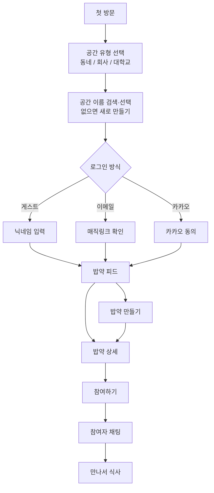
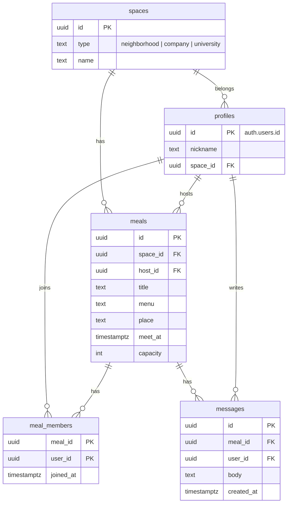
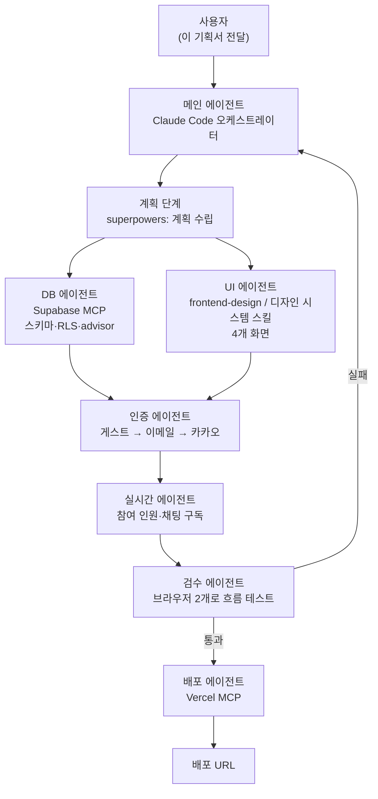

# 혼밥 탈출 — 기획서 (Claude Code 입력용)

> 혼자 밥 먹는 사람들이 같은 공간(동네·회사·대학교) 안에서 밥약을 올리고 참여하는 웹앱.
> 이 문서를 Claude Code에 그대로 넣고 "이 기획서대로 만들어 줘"라고 요청하면 된다.

## 0. 확정된 결정

| 항목 | 결정 | 근거 |
|---|---|---|
| 타깃 | 시작할 때 공간 유형(동네 / 회사 / 대학교)을 고르고, 구체적인 공간 이름을 선택하거나 새로 만든다 | 사용자 선택 |
| 매칭 방식 | 밥약 게시판형: 글을 올리고 다른 사람이 "참여" 버튼을 누른다 | 사용자 선택 |
| 로그인 | 게스트 + 이메일 + 카카오 세 가지 모두 | 사용자 선택 |
| 매칭 후 연락 | 밥약별 앱 내 실시간 채팅 (선호 없음 → 기획자가 결정) | 시연 효과가 크고 Supabase Realtime으로 짧게 구현 가능 |
| 스택 | Next.js(App Router) + Supabase + Tailwind/shadcn + Vercel (기획자가 결정) | Supabase·Vercel MCP가 이미 연결되어 있음 |

**1시간 범위에 대한 주의:** 로그인 세 가지를 모두 1시간 안에 넣는 것은 빠듯하다. 그래서 세 가지를 모두 Supabase Auth 하나로 통일하고, 게스트 → 이메일 → 카카오 순서로 붙인다. 카카오는 개발자 콘솔 설정(사람이 직접 해야 함, 약 15분)을 타이머 시작 전에 끝내 두어야 1시간 안에 들어온다. 설정이 안 끝났으면 버튼만 두고 "준비 중"으로 표시한다.

## 1. 서비스 정의

- **누구를 위한 서비스인가:** 같은 동네·회사·대학교에서 혼자 밥을 먹는 사람.
- **어떤 문제인가:** 같이 먹을 사람을 찾고 싶지만 먼저 연락하기 부담스럽고, 주변에 누가 지금 밥 먹을 사람을 찾는지 알 방법이 없다.
- **해결책:** 공간별 밥약 피드. "오늘 12시 학생식당, 3명" 같은 글을 올리면 같은 공간 사람이 한 번의 터치로 참여하고, 참여자끼리 채팅으로 만날 곳을 맞춘다.

### 유사 서비스에서 확인한 것

| 서비스 | 참고할 점 |
|---|---|
| 같이먹자 | 식당·날짜·시간·인원을 정해 글을 올리고 신청자를 수락하는 게시판형. 노쇼 방지와 매너 평가가 있음 |
| 밥만나 | 프로필 매칭 + 밥약 등록 + 실시간 채팅 + 신고/차단 |
| 점개팅 | 회사·학교 이메일 인증으로 가입 제한, 리뷰 기반 매너 점수 |

공통점: 게시판형 + 채팅이 기본이고, 신뢰 장치(인증, 매너 점수, 신고)는 그 다음 단계다. 이 MVP는 앞의 두 가지만 만든다.

## 2. 1시간 MVP 범위

### 포함 (반드시 작동)

1. **공간 선택:** 유형(동네/회사/대학교) 선택 → 이름 검색 후 선택, 없으면 새로 만들기
2. **로그인:** 게스트(닉네임만), 이메일 매직링크, 카카오
3. **밥약 피드:** 내 공간의 오늘·내일 밥약 목록 (시간순, 남은 자리 표시)
4. **밥약 만들기:** 제목, 메뉴/식당, 시간, 정원(2~6명)
5. **참여/취소:** 정원이 차면 "마감"
6. **밥약 채팅:** 참여자만 볼 수 있는 실시간 채팅
7. **Vercel 배포:** 공유 가능한 URL

### 제외 (다음 단계)

신고/차단, 매너 점수, 노쇼 관리, 푸시 알림, 지도·위치 기반 검색, 프로필 사진, 학교·회사 이메일 도메인 인증, 자동 매칭

### 잘라낼 순서 (시간이 모자랄 때)

카카오 로그인 → 이메일 로그인 → 채팅(참여자 목록만 남김). 게스트 + 피드 + 만들기 + 참여는 끝까지 지킨다.

## 3. 화면 구성

```
[1 온보딩]            [2 밥약 피드]           [3 밥약 만들기]        [4 밥약 상세 + 채팅]
┌──────────────┐     ┌──────────────┐      ┌──────────────┐      ┌──────────────┐
│ 혼밥 탈출     │     │ 삼육대  ▾     │      │ ← 밥약 만들기 │      │ ← 학식 같이   │
│              │     │ 오늘 | 내일   │      │ 제목 [      ] │      │ 12:00 학생식당│
│ 어디서 먹나요?│     │┌────────────┐│      │ 메뉴 [      ] │      │ 2/3명         │
│ (동네)(회사)  │     ││12:00 학식   ││      │ 장소 [      ] │      │ 민지 · 게스트7│
│ (대학교)      │     ││학생식당 2/3 ││      │ 시간 [12:00 ] │      │ [ 참여하기 ]  │
│ [삼육대    🔍]│     ││   [참여]    ││      │ 정원 (2)(3)(4)│      │──────────────│
│              │     │└────────────┘│      │              │      │ 민지: 정문?   │
│ [게스트 시작] │     │┌────────────┐│      │ [ 올리기 ]    │      │ 나: 좋아요    │
│ [이메일]      │     ││18:30 마라탕 ││      │              │      │ [메시지   ➤] │
│ [카카오]      │     ││후문 1/4     ││      │              │      │              │
└──────────────┘     │└────────────┘│      └──────────────┘      └──────────────┘
                     │        ( + ) │
                     └──────────────┘
```

경로: `/` (온보딩) · `/feed` · `/meals/new` · `/meals/[id]`
모바일 우선(최대 폭 480px), 한국어 UI.

### 디자인 원칙 (반드시 지킬 것)

앱 이름은 **혼밥 탈출**. 흰 배경에, 크게, 그리고 캐주얼하게. 친구가 "밥 먹자"고 말 거는 느낌이어야 하고, 관공서 양식처럼 딱딱해 보이면 실패다. 아래 값은 기본값이 아니라 요구 사항이다.

**캐주얼하게 만드는 장치**

- **말투:** 반말에 가까운 친근한 존댓말. "어디서 밥 먹나요?" → "오늘 어디서 먹어요?", "참여하기" → "나도 갈래!", "올리기" → "밥약 띄우기", 빈 피드 → "아직 조용하네요. 첫 밥약을 띄워 볼까요?"
- **모양:** 버튼과 입력창은 완전히 둥근 알약 모양. 카드 모서리는 24px.
- **색:** 배경은 흰색을 유지하고, 밥약 카드만 연한 파스텔(복숭아 `#FFF1E6`, 레몬 `#FFF8DB`, 민트 `#E3FAF0`)을 번갈아 쓴다.
- **스티커:** "1자리 남음", "방금 올라옴" 같은 상태는 살짝 기울인(-4도) 스티커 배지로 붙인다.
- **이모지:** 메뉴 종류마다 음식 이모지 하나를 크게 보여 준다 (🍚 🍜 🍕 🌶️). 그 외 장식 이모지는 쓰지 않는다.
- **아바타:** 참여자는 닉네임 첫 글자가 들어간 색 동그라미로 보여 준다.
- **글꼴:** 로고와 화면 제목만 둥근 한글 글꼴(Jua 등)을 쓰고, 본문은 Pretendard.
- **움직임:** 버튼을 누르면 살짝 눌렸다 튀어 오르고, 참여에 성공하면 짧은 축하 효과를 한 번 보여 준다.

| 항목 | 규칙 |
|---|---|
| 배경 | 모든 화면 배경은 흰색 `#FFFFFF`. 회색 배경, 그라데이션, 그림자, 다크 모드 없음 |
| 글자색 | 본문 `#111111`, 보조 `#666666`. 그 외 색 글자 없음 |
| 강조색 | 한 가지만 사용 (`#E8590C`). 주요 버튼과 선택된 항목에만 쓴다 |
| 글자 크기 | 본문 16px, 보조 14px, 화면 제목 22px, 밥약 시간 22px, 스티커 12px |
| 글자와 도형 | 버튼·칩·스티커 안의 글자는 반드시 한 줄(`white-space: nowrap`)이고 좌우 여백 16px 이상을 남긴다. 넘치면 도형을 키우지 말고 문구를 줄인다. 360px 폭 화면에서 넘치거나 줄바꿈되는 곳이 없는지 확인한다 |
| 버튼 | 높이 56px 이상, 화면 폭 전체, 알약 모양. 한 화면에 주요 버튼은 하나 |
| 입력창 | 높이 56px, 글자 16px, 알약 모양, 배경 `#F6F6F6`, 테두리 없음 |
| 터치 영역 | 누를 수 있는 모든 요소는 48px 이상 |
| 간격 | 화면 좌우 여백 20px, 요소 사이 16px 이상 |
| 카드 | 테두리 없음, 모서리 24px, 파스텔 배경. 한 카드에는 이모지, 시간, 제목, 장소, 참여자만 |
| 장식 | 위의 캐주얼 장치만 쓴다. 그라데이션, 그림자, 일러스트는 없음 |
| 한 화면 한 가지 일 | 온보딩은 단계별로 한 가지씩 묻는다 (공간 유형 → 공간 이름 → 로그인) |

## 4. 사용자 흐름



## 5. 데이터 모델



### 스키마 (Supabase 마이그레이션으로 적용)

```sql
create type space_type as enum ('neighborhood', 'company', 'university');

create table spaces (
  id uuid primary key default gen_random_uuid(),
  type space_type not null,
  name text not null check (char_length(name) between 2 and 30),
  created_at timestamptz not null default now(),
  unique (type, name)
);

create table profiles (
  id uuid primary key references auth.users(id) on delete cascade,
  nickname text not null check (char_length(nickname) between 2 and 12),
  space_id uuid references spaces(id),
  created_at timestamptz not null default now()
);

create table meals (
  id uuid primary key default gen_random_uuid(),
  space_id uuid not null references spaces(id),
  host_id uuid not null references profiles(id) on delete cascade,
  title text not null check (char_length(title) between 2 and 40),
  menu text,
  place text not null,
  meet_at timestamptz not null,
  capacity int not null check (capacity between 2 and 6),
  created_at timestamptz not null default now()
);
create index on meals (space_id, meet_at);

create table meal_members (
  meal_id uuid references meals(id) on delete cascade,
  user_id uuid references profiles(id) on delete cascade,
  joined_at timestamptz not null default now(),
  primary key (meal_id, user_id)
);

create table messages (
  id uuid primary key default gen_random_uuid(),
  meal_id uuid not null references meals(id) on delete cascade,
  user_id uuid not null references profiles(id) on delete cascade,
  body text not null check (char_length(body) between 1 and 500),
  created_at timestamptz not null default now()
);
create index on messages (meal_id, created_at);

-- 정원 초과를 막는 참여 함수 (meals 행을 잠가서 동시 참여를 직렬화)
create or replace function public.join_meal(p_meal_id uuid)
returns void language plpgsql security definer set search_path = public as $$
declare v_cap int; v_cnt int;
begin
  if auth.uid() is null then raise exception 'not signed in'; end if;
  select capacity into v_cap from meals where id = p_meal_id for update;
  if v_cap is null then raise exception 'meal not found'; end if;
  select count(*) into v_cnt from meal_members where meal_id = p_meal_id;
  if v_cnt >= v_cap then raise exception 'meal is full'; end if;
  insert into meal_members (meal_id, user_id) values (p_meal_id, auth.uid())
  on conflict do nothing;
end $$;

alter table spaces enable row level security;
alter table profiles enable row level security;
alter table meals enable row level security;
alter table meal_members enable row level security;
alter table messages enable row level security;

-- 읽기: 로그인한 사용자(게스트 포함)
create policy "read spaces" on spaces for select to authenticated using (true);
create policy "create spaces" on spaces for insert to authenticated with check (true);
create policy "read profiles" on profiles for select to authenticated using (true);
create policy "upsert own profile" on profiles for insert to authenticated with check (id = auth.uid());
create policy "update own profile" on profiles for update to authenticated using (id = auth.uid());
create policy "read meals" on meals for select to authenticated using (true);
create policy "host creates meal" on meals for insert to authenticated with check (host_id = auth.uid());
create policy "host deletes meal" on meals for delete to authenticated using (host_id = auth.uid());
create policy "read members" on meal_members for select to authenticated using (true);
create policy "leave meal" on meal_members for delete to authenticated using (user_id = auth.uid());
-- 참여(insert)는 join_meal 함수로만 한다. insert 정책을 만들지 않는다.

-- 채팅: 참여자만 읽고 쓴다
create policy "members read messages" on messages for select to authenticated
  using (exists (select 1 from meal_members m where m.meal_id = messages.meal_id and m.user_id = auth.uid()));
create policy "members write messages" on messages for insert to authenticated
  with check (user_id = auth.uid() and exists (
    select 1 from meal_members m where m.meal_id = messages.meal_id and m.user_id = auth.uid()));

alter publication supabase_realtime add table messages;
alter publication supabase_realtime add table meal_members;
```

밥약을 만든 사람은 만들자마자 `join_meal`을 호출해 첫 참여자가 된다.

## 6. 로그인 설계

세 가지 모두 Supabase Auth를 쓰므로 `auth.uid()`가 항상 있고, RLS 정책을 한 벌만 쓰면 된다.

| 방식 | 구현 | 사전 설정 |
|---|---|---|
| 게스트 | `supabase.auth.signInAnonymously()` 후 닉네임으로 `profiles` 생성 | Supabase 대시보드에서 Anonymous sign-ins 켜기 |
| 이메일 | `supabase.auth.signInWithOtp({ email })` 매직링크 | Site URL과 Redirect URLs에 localhost와 Vercel 주소 등록 |
| 카카오 | `supabase.auth.signInWithOAuth({ provider: 'kakao' })` | Kakao Developers 앱 생성, 카카오 로그인 활성화, Redirect URI에 `https://<project-ref>.supabase.co/auth/v1/callback` 등록, REST API 키와 Client Secret을 Supabase Kakao provider에 입력 |

로그인 후 `profiles` 행이 없으면 닉네임 입력 화면을 한 번 보여 준다.

## 7. 개발 과정 (60분 타임박스)

```mermaid
gantt
    title 혼밥 탈출 60분 개발 계획
    dateFormat HH:mm
    axisFormat %M분
    section 준비
    프로젝트 생성·Supabase 연결      :a1, 00:00, 5m
    section 백엔드
    스키마·RLS·게스트 로그인 설정    :a2, 00:05, 10m
    section 화면
    온보딩(공간 선택+게스트)         :a3, 00:15, 10m
    피드·만들기·참여                 :a4, 00:25, 15m
    밥약 채팅                        :a5, 00:40, 10m
    section 마무리
    이메일·카카오 버튼 연결          :a6, 00:50, 5m
    Vercel 배포·점검                 :a7, 00:55, 5m
```



**타이머 시작 전에 사람이 해 둘 일 (약 15분)**

1. Supabase 프로젝트 생성, Anonymous sign-ins 켜기
2. Kakao Developers 앱 생성과 위 표의 카카오 설정
3. Claude Code에 Supabase MCP, Vercel MCP 연결

**각 단계 완료 기준**

| 분 | 단계 | 완료 기준 |
|---|---|---|
| 0–5 | 프로젝트 생성 | `npm run dev`로 빈 화면이 뜨고 `.env.local`에 Supabase URL·키가 있다 |
| 5–15 | DB | 5절 SQL이 적용되고 보안 advisor에 경고가 없다 |
| 15–25 | 온보딩 | 공간을 고르고 게스트로 들어가면 `/feed`로 이동한다 |
| 25–40 | 피드·만들기·참여 | 브라우저 두 개로 한쪽이 올린 밥약에 다른 쪽이 참여하고, 정원이 차면 마감된다 |
| 40–50 | 채팅 | 두 브라우저에서 메시지가 새로고침 없이 보인다 |
| 50–55 | 이메일·카카오 | 각 버튼으로 로그인이 되거나, 설정이 없으면 "준비 중"으로 표시된다 |
| 55–60 | 배포 | Vercel URL에서 전체 흐름이 작동한다 |

## 8. 에이전트 구조



- DB 에이전트와 UI 에이전트는 서로 의존하지 않으므로 병렬로 돌린다. UI는 5절의 타입을 기준으로 먼저 만든다.
- 검수 에이전트는 코드를 만든 에이전트와 분리한다. 7절의 완료 기준만 보고 판정한다.
- 1시간 범위에서는 서브에이전트를 3개(DB, UI, 검수)만 써도 충분하다. 인증·실시간·배포는 메인 에이전트가 직접 한다.

## 9. 개발 중 생길 수 있는 이슈

| # | 이슈 | 대응 |
|---|---|---|
| 1 | **카카오 이메일 동의항목.** 카카오는 이메일 동의항목을 쓰려면 앱 심사나 비즈 앱 전환이 필요할 수 있고, Supabase는 기본으로 이메일을 요청한다. 동의항목이 안 맞으면 로그인이 오류로 끝난다 | 닉네임만 동의받고 Supabase Kakao provider의 "이메일 없는 사용자 허용" 옵션을 켠다. 옵션 이름과 위치는 Supabase 문서로 확인한다 |
| 2 | **이메일 발송 한도.** Supabase 기본 메일 서버는 시간당 발송 수가 매우 적어 시연 중 막힐 수 있다 | 시연은 게스트 위주로 하고, 실제 운영 때는 자체 SMTP(Resend 등)를 연결한다 |
| 3 | **리다이렉트 주소.** 매직링크와 카카오가 localhost로 돌아가거나 배포 주소에서 실패한다 | Supabase의 Site URL, Redirect URLs에 두 주소를 모두 등록하고 `redirectTo`를 `window.location.origin` 기준으로 준다 |
| 4 | **게스트 계정 유실.** 브라우저 데이터를 지우면 게스트 계정과 밥약 기록이 사라진다 | 화면에 안내 문구를 두고, 다음 단계에서 게스트를 이메일·카카오 계정으로 연결한다 |
| 5 | **게스트 남용.** 누구나 계정을 무한히 만들 수 있다 | Supabase의 익명 로그인 속도 제한을 유지하고, 운영 전에는 CAPTCHA를 붙인다 |
| 6 | **RLS 실수.** RLS를 켜고 정책이 없으면 목록이 빈 배열로 나와 버그처럼 보인다 | 5절 정책을 그대로 쓰고, 적용 뒤 Supabase 보안 advisor를 실행한다 |
| 7 | **실시간이 안 옴.** 테이블이 realtime publication에 없거나 select 정책이 없으면 이벤트가 오지 않는다 | 5절 마지막 두 줄을 확인하고, 구독은 클라이언트 컴포넌트에서 로그인 이후에 시작한다 |
| 8 | **정원 초과.** 두 사람이 동시에 마지막 자리에 참여한다 | 직접 insert하지 않고 `join_meal` 함수만 쓴다 |
| 9 | **시간대.** 서버는 UTC, 사용자는 한국 시간이라 "오늘" 목록이 어긋난다 | `timestamptz`로 저장하고 조회 범위와 표시는 `Asia/Seoul` 기준으로 계산한다 |
| 10 | **Next.js·Supabase 버전 차이.** 쿠키 기반 세션 코드가 버전마다 다르다 | 기억에 의존하지 말고 Supabase MCP의 문서 검색이나 `create-next-app --example with-supabase`의 최신 코드를 따른다 |
| 11 | **공간 이름 중복.** "삼육대"와 "삼육대학교"가 따로 생긴다 | 새로 만들기 전에 반드시 검색 결과를 보여 주고, 앞뒤 공백을 제거한다 |
| 12 | **빈 피드.** 첫 사용자는 아무 글도 못 본다 | 빈 상태 화면에 "첫 밥약 올리기" 버튼을 크게 두고, 시연용 예시 밥약을 몇 개 넣어 둔다 |
| 13 | **안전.** 모르는 사람과의 만남이다 | MVP에서는 공개된 식당만 장소로 쓰도록 안내 문구를 넣는다. 신고/차단은 공개 운영 전에 반드시 추가한다 |
| 14 | **개인정보.** 이메일·카카오 계정을 수집한다 | 닉네임만 다른 사용자에게 보이게 하고, 공개 운영 전에 개인정보 처리방침을 둔다 |

## 10. 추천 스킬과 MCP

### MCP

| MCP | 용도 | Claude Code 연결 |
|---|---|---|
| Supabase | 프로젝트 조회, 마이그레이션 적용, advisor, 문서 검색 | `claude mcp add --transport http supabase https://mcp.supabase.com/mcp` |
| Vercel | 배포, 빌드 로그, 환경 변수 | `claude mcp add --transport http vercel https://mcp.vercel.com` |
| Context7 | Next.js·Supabase 최신 문서 조회 | 선택 |
| Playwright | 브라우저 두 개로 참여·채팅 흐름 자동 점검 | 선택 |

연결 명령은 버전에 따라 달라질 수 있으니 각 서비스 문서에서 확인한다.

### 스킬 / 플러그인

| 이름 | 용도 |
|---|---|
| superpowers | 계획 수립 → 단계별 실행 → 검증 흐름 |
| frontend-design | 화면이 템플릿처럼 보이지 않게 하는 디자인 방향 |
| impeccable | 완성된 화면의 디자인 다듬기 |
| supabase/agent-skills | Supabase 개발·보안 지침 (`npx skills add supabase/agent-skills`) |
| sahmyook-launch-ds | 설치했다면 이 디자인 시스템을 색·글꼴·컴포넌트의 기준으로 쓴다 |

## 11. 깃헙 참고 자료 (별표 많은 순)

별표 수는 대략적인 규모다. 이 문서를 만든 환경에서 깃헙 실시간 조회가 막혀 있었으므로 정확한 수치는 각 저장소에서 확인한다.

| 순 | 저장소 | 별표(대략) | 참고할 부분 |
|---|---|---|---|
| 1 | vercel/next.js | 13만 이상 | `examples/with-supabase`: Next.js + Supabase 인증 스타터. 프로젝트 시작점 |
| 2 | shadcn-ui/ui | 10만 이상 | 카드, 버튼, 다이얼로그, 폼 컴포넌트 |
| 3 | supabase/supabase | 9만 이상 | `examples/slack-clone`: RLS가 걸린 실시간 채팅. Supabase UI Library의 Realtime Chat·소셜 로그인 블록 |
| 4 | calcom/cal.com | 3만 이상 | 약속 시간·정원·시간대 처리 방식 |
| 5 | supabase/supabase-js | 수천 | 클라이언트 API (auth, realtime, rpc) |
| 6 | freeCodeCamp/chapter | 약 1.9천 (2025년 9월 보관됨) | 모임·참석(RSVP) 데이터 모델 |

Supabase UI Library의 Realtime Chat 블록은 기본이 저장 없는 브로드캐스트 방식일 수 있다. 이 기획은 `messages` 테이블에 저장하므로, 블록을 쓰더라도 저장과 불러오기를 직접 연결해야 한다.

## 12. 최종 산출물

- 배포 URL 하나 (Vercel)
- 화면 4개: 온보딩, 밥약 피드, 밥약 만들기, 밥약 상세 + 채팅 (3절 참고)
- Supabase 테이블 5개와 RLS 정책, `join_meal` 함수
- 시연 시나리오: 브라우저 A가 "삼육대"에서 게스트로 밥약을 올린다 → 브라우저 B가 같은 공간에서 참여한다 → 인원이 2/3으로 바뀐다 → 둘이 채팅한다

## 13. Claude Code 실행 지시

1. 이 문서 전체를 읽고 7절 순서대로 진행한다. 각 단계의 완료 기준을 통과한 뒤 다음 단계로 간다.
2. `npx create-next-app -e with-supabase`로 시작하고 TypeScript, Tailwind, shadcn/ui를 쓴다.
3. 5절 SQL은 Supabase MCP의 마이그레이션으로 적용하고, 적용 뒤 보안 advisor를 실행한다.
4. 참여는 반드시 `supabase.rpc('join_meal', { p_meal_id })`로 한다.
5. UI 문구는 한국어, 모바일 우선, 시간은 `Asia/Seoul` 기준.
6. 카카오·이메일 설정값이 없으면 멈추지 말고 버튼을 "준비 중"으로 두고 계속 진행한다.
7. 시간이 모자라면 2절의 "잘라낼 순서"를 따른다.
8. 끝나면 12절 시연 시나리오를 실제로 실행해 보고 결과를 보고한다.

## 출처

- 같이먹자: https://www.asiae.co.kr/en/article/2020110510350590976
- 밥만나: https://apps.apple.com/us/app/id6670421298
- 점개팅: https://apps.apple.com/kr/app/id6756857667
- Supabase UI Library: https://supabase.com/blog/supabase-ui-library
- freeCodeCamp/chapter 보관 정보: https://www.rapidevelopers.com/md/clone/meetup
